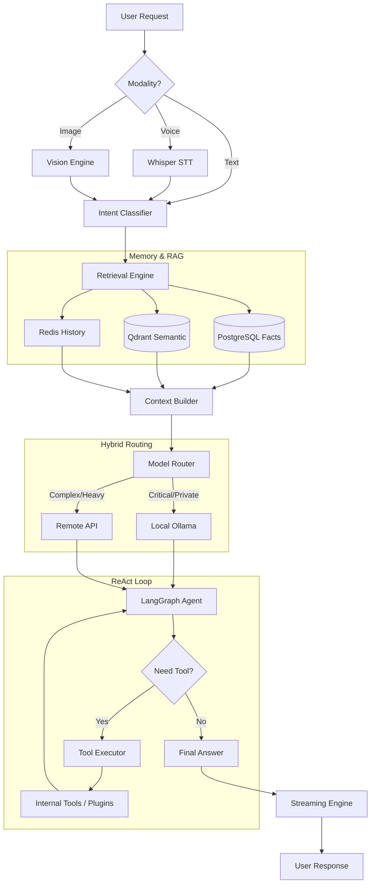

# 🏯 Kimiko AI: Comprehensive Codebase Analysis Report

## 1. Executive Summary
Kimiko AI is a **local-first, multimodal, and extensible AI agent platform**. It is designed to run sophisticated AI agents on consumer-grade hardware (like a laptop with an RTX GPU) while maintaining deep, personalized memory through a three-tier storage system. The platform is modular, allowing for easy expansion through a dynamic plugin ecosystem.

---

## 2. Core Technology Stack

### Backend
- **Language**: Python 3.11+
- **Web Framework**: FastAPI (Asynchronous, high-performance)
- **Agent Orchestration**: LangGraph & LangChain (For stateful, multi-step agent logic)
- **AI Models**: 
  - **Ollama**: Local model runner (serving Qwen2.5, Qwen2-VL)
  - **Whisper**: Speech-to-Text (STT)
  - **Piper**: Text-to-Speech (TTS)
- **Task Queue**: Celery with Redis (For background fact extraction and maintenance)

### Frontend
- **Framework**: Next.js (React 19)
- **STyling**: Tailwind CSS 4.0
- **Language**: TypeScript

### Data & Infrastructure
- **PostgreSQL**: Long-term structured data (User identities, preferences, facts)
- **Qdrant**: Vector database for semantic search (Retrieval Augmented Generation - RAG)
- **Redis**: High-speed cache for recent conversation history and message broker.
- **Docker**: Containerization and orchestration.

---

## 3. System Architecture

Kimiko follows a **Modular Pipeline** design. Every request flows through a series of dedicated engines:



### Key Subsystems:
1.  **Memory Manager**: Mimics human recall with three tiers (Short, Middle, Long term).
2.  **Fact Evolution Cycle**: A background process that extracts structured facts from text and applies "forgetting" (exponential decay) to keep memory relevant.
3.  **Model Scheduler**: Manages VRAM by swapping models in/out of the GPU based on use.
4.  **Plugin Engine**: Dynamically registers new tools into the agent's reasoning loop.

---

## 4. Folder-by-Folder Breakdown

### Root Directory
- `Dockerfile` & `docker-compose.yml`: Orchestration for the entire stack.
- `pyproject.toml`: Backend dependencies and Python environment setup.
- `alembic/`: Database migration scripts for PostgreSQL.
- `docs/`: In-depth documentation for architecture, memory, and plugins.

### Backend (`src/kimiko/`)
- `agents/`: The "brain". Contains the LangGraph engine (`engine.py`) and agent prompts.
- `api/`: REST and WebSocket endpoints. `v1/` contains versioned routes for chat, memory, and plugins.
- `core/`: Core internal logic, including the model router and hardware scheduler.
- `db/`: Database configuration and SQLAlchemy models.
- `memory/`: The memory system.
    - `fact_extraction.py`: AI-powered logic to learn about the user.
    - `semantic.py`: Interface for Qdrant (vector search).
    - `short_term.py`: Redis-based history management.
- `plugins/`: The extension layer. `installed/` includes the active plugins.
- `services/`: Implementation of core features like vision and voice processing.
- `workers/`: Celery task definitions for background processing.

### Frontend (`web/`)
- `src/app/`: Next.js App Router structure.
    - `/agent`: The main chat interface.
    - `/memory`: Dashboard to visualize what Kimiko knows.
    - `/metrics`: System performance and VRAM monitoring.
    - `/plugins`: UI for enabling/disabling extensions.
- `src/components/`: Reusable UI elements (Chat bubbles, Sidebar, etc.).

---

## 🚀 Quick Start (Complete App)

To start everything (AI Engines, Databases, Backend, and Frontend) in one go:

```powershell
# 1. Start all containers
docker-compose up -d --build

# 2. Wait 30 seconds, then start the OS Assistant service
python -m kimiko.os.assistant
```

---

## 5. Setup and Running

### Prerequisites
- **Docker & Docker Compose**
- **NVIDIA GPU** (Recommended 6GB+ VRAM)

### Step-by-Step Installation
1.  **Clone the Repo**:
    ```bash
    git clone <repo_url>
    cd Kimiko
    ```
2.  **Configure Environment**:
    - Copy `.env.example` to `.env`.
    - Edit `.env` to set passwords and API keys (if using remote providers).
### Option 1: The Complete App (Docker - Recommended)
This starts all services (PostgreSQL, Qdrant, Redis, Ollama, Backend, and Frontend) in a single command.

1.  **Launch Infrastructure**:
    ```powershell
    docker-compose up -d --build
    ```
2.  **Prepare Models**:
    Pull the required local models into Ollama:
    ```bash
    docker exec -it kimiko-ollama ollama pull qwen2.5
    docker exec -it kimiko-ollama ollama pull qwen2-vl
    docker exec -it kimiko-ollama ollama pull nomic-embed-text
    ```
3.  **Access the Dashboard**:
    - **Backend API**: `http://localhost:8000/docs` (Swagger)
    - **Frontend UI**: `http://localhost:3000`

### Option 2: Manual Component Startup (Local Development)
If you want to run components separately for development:

#### A. Backend API (FastAPI)
```powershell
# From the project root
pip install -e .
uvicorn kimiko.main:app --reload --port 8000
```

#### B. Frontend Dashboard (Next.js)
```powershell
cd web
npm install
npm run dev
```

#### C. OS Assistant Overlay (Electron)
To use the Ctrl+Space overlay, you need both the background service and the UI:
1.  **Terminal 1 (Backend Service)**:
    ```powershell
    python -m kimiko.os.assistant
    ```
2.  **Terminal 2 (Electron UI)**:
    ```powershell
    cd src/kimiko/os/ui-electron
    npm install
    npm start
    ```

#### D. Running the CLI Tool
To use the `kimiko` command from your terminal, verify it's installed in editable mode:
```powershell
# Run once from project root
pip install -e .

# Then use the tool:
kimiko status
kimiko chat
```

---

## 6. Development Workflow
- **Adding a Plugin**: Create a new module in `src/kimiko/plugins/installed/` following the `base.py` interface.
- **Database Changes**: Modify models in `src/kimiko/db/models/` and run `alembic revision --autogenerate`.
- **Testing**: Run `pytest` from the root directory to execute the automated test suite.
