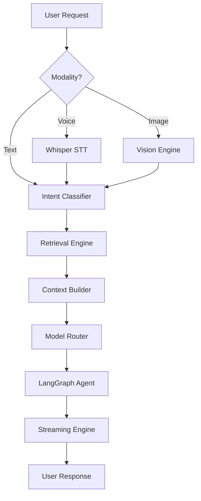

# 🏗️ Kimiko Architecture

Kimiko is built with a modular, pipeline-based architecture designed for low latency, local-first privacy, and high extensibility.

## 🔄 High-Level Request Flow

Every user request follows this pipeline:

---

## 🧩 Core Components

### 1. Request Orchestrator
The "Heart" of Kimiko. It initializes all subsystems (Memory, Agent, Model Scheduler) and manages the state of each request.

### 2. Memory System
A hybrid architecture combining:
- **Fact Store (PostgreSQL)**: Structured identities and preferences with confidence scoring.
- **Semantic Store (Qdrant)**: Unstructured knowledge embeddings.
- **Cache (Redis/Dict)**: Recent conversation history for immediate context.

### 3. Agentic Pipeline
Powered by **LangGraph**, the agent can:
- Reason over multimodal inputs (Vision).
- Call internal tools (Calculator, Search).
- Execute external dynamic **Plugins**.

### 4. Model Scheduler
A hardware-aware manager that swaps models in/out of the GPU. It enforces `keep_alive` durations to optimize for cards with limited VRAM (e.g., RTX 4050).

### 5. Plugin System
Allows on-the-fly capability extension. Plugins are isolated Python modules that self-register namespaced tools (e.g., `weather.get_current`).

---

## 🔒 Security & Isolation
- **User Constraints**: Every database and vector query is bounded by a `user_id` uuid.
- **Privacy Buckets**: Intents like `CHAT` are white-listed for local-only execution.
- **Namespacing**: Plugin tools are automatically prefixed to prevent core system hijacking.
