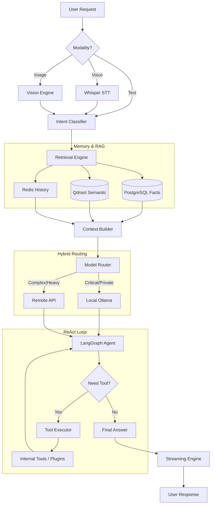
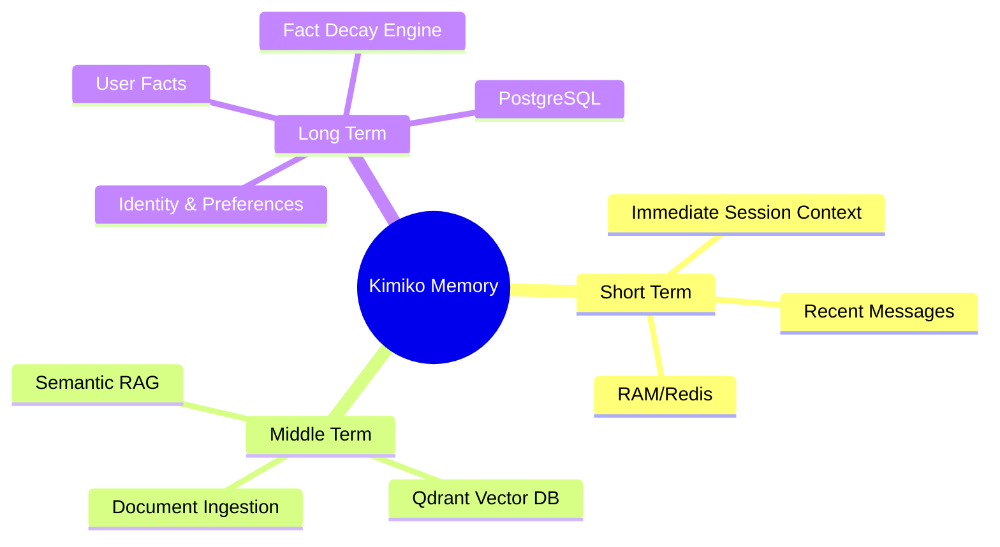
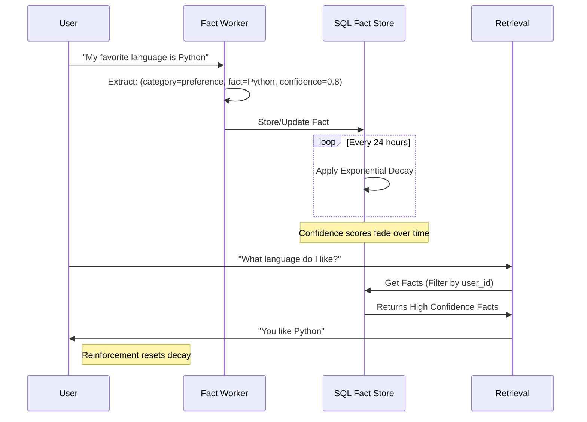

# 📊 Kimiko Visualizations

This document provides visual representations of Kimiko's internal logic, architecture, and memory systems.

## 1. System Overview (High-Level Flow)

The following diagram shows how a request travels from the user through the multimodal layers to the final response.



---

## 2. Hybrid Memory Logic

Kimiko's memory mimics human recall: immediate history for context, semantic search for associations, and structured facts for identity.



---

## 3. Fact Evolution Cycle

How Kimiko learns and reinforces knowledge about the user.



---

## 4. Plugin Ecosystem

Kimiko's extensibility model.

```mermaid
flowchart LR
    subgraph Core
        O[Orchestrator]
        TR[Tool Registry]
    end
    
    subgraph PluginsDir [src/kimiko/plugins/installed/]
        P1[Weather Plugin]
        P2[Custom Plugin]
    end
    
    PM[Plugin Manager] -- Scans --> PluginsDir
    PM -- Instantiates --> P1
    PM -- Registers Tools --> TR
    
    TR -- Namespaced Tool --> OA[Agent]
    Note over TR: weather.get_current<br/>custom.my_tool
```
